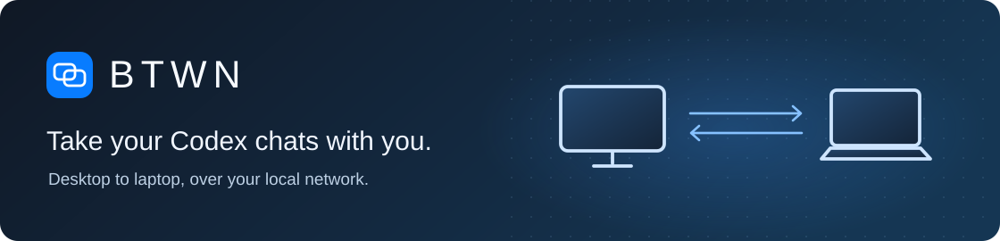

# BTWN

**PC-to-PC sync for local Codex projects.** Open a project on your other Windows PC and pick up at the last saved message, with its files and Codex sidebar organized the way you left them. Either PC can send or receive over private Wi-Fi or wired LAN. Once the receiving PC confirms the sync, the other PC can go offline.

[First-time setup](#first-time-setup) · [Features](#what-btwn-syncs) · [Controls](#sync-controls) · [Settings](#settings) · [Troubleshooting](#troubleshooting)

## First-time setup

1. **Install on both PCs.** Download the Windows x64 MSI from [Releases](https://github.com/iaMO3/BTWN/releases/latest). Use the same current version of Codex on both PCs. Open Codex and save a local chat on each so both profiles are initialized.
2. **Pair the PCs.** Open BTWN on the same private network. On either PC, click **Create pairing file**. Share the JSON privately with the other PC and click **Open pairing file** there. The first PC hosts the connection. Either one can initiate a sync.
3. **Send your projects.** Fully quit Codex or ChatGPT on both PCs, including the tray. Leave BTWN open. On the PC containing the work you want to take with you, choose **Send**, turn on **Include project files**, and click **Start sync**.
4. **Continue on the other PC.** Wait for BTWN to confirm completion. Open Codex on the receiving PC, select a familiar project, and check its latest chat and a working file. For a later transfer in the other direction, choose **Send** on that PC.

> [!IMPORTANT]
> The pairing file grants access to your pair. Share it only with your other PC. If you need another copy, open **Settings → Transfers → Export pairing file** on the hosting PC.

## What BTWN syncs

| Feature | What you get on the receiving PC |
| --- | --- |
| **Local project files** | With **Include project files** on, BTWN scans registered local project folders, skips identical files, and copies missing files. An existing project uses its local folder. You can choose where new projects go. |
| **Saved conversations** | New chats and later turns travel with local Codex history, including saved active and archived sessions. Receiver-only chats are preserved. BTWN checks related and forked histories before changing a shared conversation. |
| **Project sidebar** | Project names, icons, colors, order, chat groups, and expanded or collapsed projects. BTWN also carries supported sidebar preferences such as width, sorting, and how recents are displayed. Receiver-only projects are retained. |
| **Attachments and linked outputs** | BTWN collects eligible local files it can still find in saved messages, including images and documents. Recovered copies are accessible under **Received → Attachments**. An older message can still link to its original PC path. |

Project scans skip linked folders and common generated or private files, including `.git`, `node_modules`, build caches, `.env`, key files, and local database files. Leaving **Include project files** off lets you transfer chat history, available attachments, and the sidebar without copying the project folders.

## Sync controls

| Select on either PC | Use it when… |
| --- | --- |
| **Send** | This PC has the project and conversation history you want on the other PC. |
| **Receive** | The paired PC has the work you want on this one. |
| **Automatic** | You work on both PCs. BTWN checks both directions about every two minutes while it is open and the PCs can reach each other. Divergent chat histories are kept for review. |

**Watch or pause from either PC.** The dashboard shows the paired device names, connection state, and transfer direction. Both PCs use the receiver's reported progress. When a stage has a known total, both show its percentage. **Pause sync** pauses the pair. **Resume sync** continues the selected mode.

### What happens during a sync

1. **Compare.** BTWN checks the saved history and file index, reuses verified content, and requests the project files the receiver needs. It can send project files directly from their source folders without staging a second copy of the project tree.
2. **Restore.** BTWN applies and checks chats and sidebar changes before transferring larger project files. If a transfer is interrupted, a retry can reuse verified files and completed restore steps.
3. **Confirm.** The receiving PC reports its result to both windows. **Everything selected is synced** or **Chats and sidebar are synced** means you can reopen Codex. **Sync finished with items to review** means some versions were saved separately.

### If both PCs changed something

Open **Settings → Transfers → Open received files** on the receiving PC. Open the folder for the transfer you want to inspect.

| Situation | Where your work goes |
| --- | --- |
| Both PCs have a different file at the same project path | The local file stays in place. The incoming version is saved under **Project conflicts**. |
| A one-way sync needs to replace a shared chat with the sender's history | BTWN verifies a recoverable copy before replacing the local version. **Previous chat versions.json** points to the recovery data when this applies. |
| A chat diverged in Automatic mode, or replacing it would affect a receiver-only fork | BTWN preserves the separate histories. **Chats to review.json** identifies the chats and the saved incoming copy. |

## Settings

| Tab | Available controls |
| --- | --- |
| **My device** | Name each PC so you can recognize it in both windows. Leave the type as **PC** or choose a desktop or laptop appearance. Pick **Auto**, **Monitor**, **Notebook**, **Tower**, or **Mini** as the icon, preview it, then click **Save changes**. |
| **Transfers** | Choose or reset the destination for new projects, open received files, and check the network port. The hosting PC can export its pairing file. The PC that joined can adjust the discovery timeout from 500 to 5,000 ms. |
| **Appearance** | Choose **Light**, **Dark**, or **Match Windows**. Use the dashboard theme button for a quick switch. **Reduce motion** controls animations, and BTWN respects the Windows animation preference. |

The dashboard adapts as you resize it. Wide windows put device status and sync controls side by side. Short, narrow windows keep the main action within reach while the content scrolls. Settings keeps its tabs and Save or Done button accessible.

## Connection and storage

- **Local discovery.** Paired PCs find each other using authenticated discovery on the LAN. Transfers use HTTPS pinned to the hosting PC's certificate, and received content is verified with SHA-256 checksums.
- **Windows integration.** The MSI installs BTWN in Program Files, adds a Start menu entry, and registers private-network firewall rules for local-subnet TCP and UDP port **53328**. The release includes an installer checksum. The MSI is unsigned.
- **Local storage.** BTWN stores pairing, transfer, receipt, and recovery data under `%LOCALAPPDATA%\BTWN`. New project files default to `Documents\Desktop-Projects-Initial` for a standard Codex profile. Choose another folder under **Settings → Transfers**.
- **Compatibility.** BTWN reads the Windows Codex app's local project and chat storage. ChatGPT website conversations and cloud workspace memberships are outside its scope. The receiving PC must have the same or a newer app version than the sender.

## Troubleshooting

<strong>The paired PC stays on “Searching”</strong>

Open BTWN on both PCs and confirm they are on the same trusted LAN. Guest Wi-Fi can isolate devices even when the network name matches. Check the Windows **Private** network profile and the hosting PC's firewall rule. If discovery is slow, increase **Discovery timeout** on the PC that opened the pairing file.

<strong>A chat is older than expected, or a project file is missing</strong>

Finish the conversation and fully quit Codex on both PCs. Choose **Send** on the machine with the latest saved turn. For a working file, confirm **Include project files** is on and the file belongs to a registered local project folder. Wait for the receiver's confirmation and check **Open received files** for conflicts or recovered attachments.

<strong>I'm upgrading from an earlier release</strong>

Public 1.1.x releases use the same pairing format. An existing 1.1.0 pairing and custom device names carry forward. If you used a private preview, install the public release on both PCs and create a fresh pairing file.

<strong>I want to report a problem</strong>

Include the BTWN and Codex versions on both PCs, the sync direction, and the exact status text. Redact device names and personal paths. Keep pairing files, private keys, chat databases, and conversation text out of public issues. [Report a problem](https://github.com/iaMO3/BTWN/issues)

## License

BTWN is free to install and use. The author retains all other rights. Third-party components retain their own licenses, included with the installer. BTWN is an independent app and is unaffiliated with OpenAI. [Software license](LICENSE.txt)
